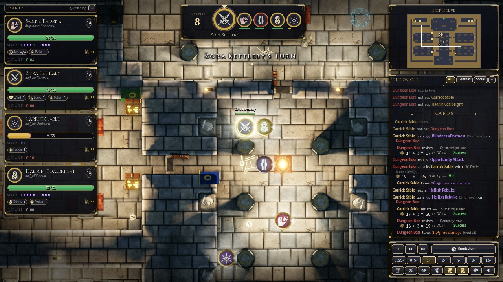
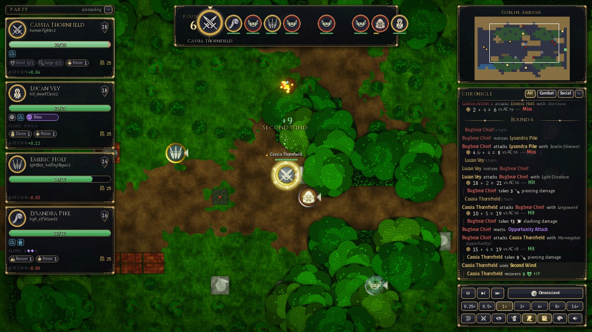
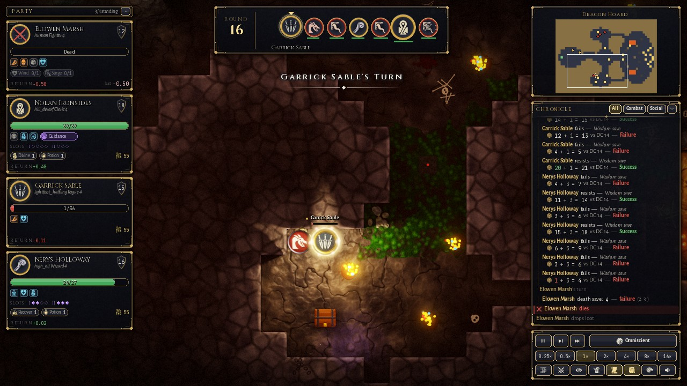
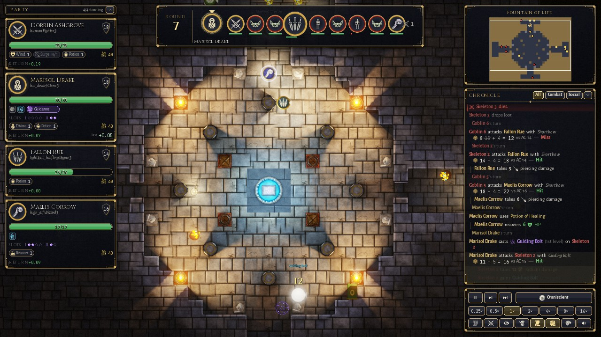
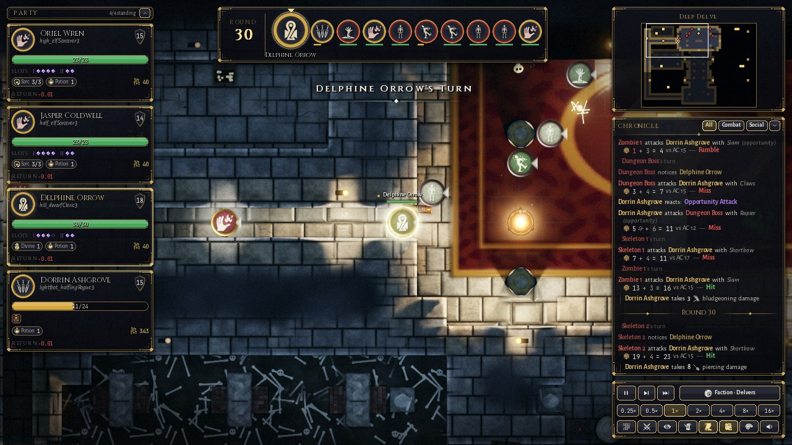
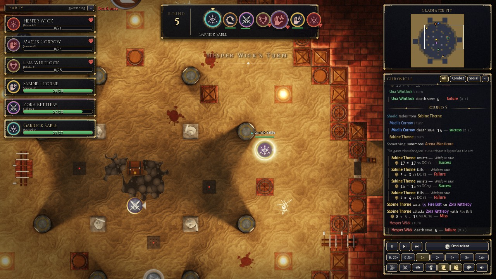
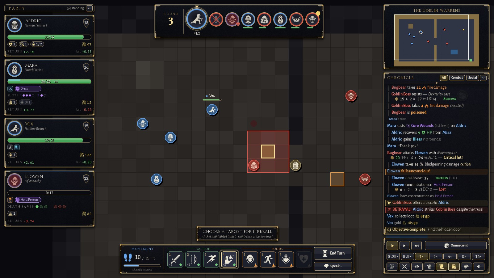

# Emberdeep

**A multi-agent reinforcement-learning environment for cooperation and social dilemmas, built on the
5e System Reference Document (SRD 5.1) tabletop fantasy rules.**

Emberdeep turns tactical fantasy role-playing — parties of adventurers, monsters, spells, loot,
truces and betrayals — into a research environment. Agents share some goals (survive, defeat the
monsters) and compete over others (gold, safety, who takes the risk), so the games are
**general-sum**: stag hunts, prisoner's dilemmas, common-pool resources, public goods, volunteer's
dilemmas and coalition games all arise from one consistent rule system.

It has two faces:

* **Training mode** — headless, deterministic, clonable, no graphics imports. PettingZoo AEC &
  Parallel APIs, a Gymnasium single-agent wrapper, subprocess vector environments, centralised
  state for CTDE, reward components with social-value mixing, and Melting-Pot-style social metrics.
* **Render mode** — an OpenGL presentation layer: dynamic torchlight with soft shadows, normal-mapped
  procedural materials, fog of war per agent, animated tokens, spell VFX, bloom & colour grading, a
  full game HUD (initiative, party frames, dice-level combat log, inspector, minimap), procedural
  audio, human play, replays and video export.



| | |
|---|---|
|  |  |
|  |  |
|  |  |

*Real games (rules engine + scripted AI) rendered from replays — the crypt frame shows one faction's fog of
war. The lower-right image is the HUD's human-play action bar with an area-of-effect preview, captured in the
HUD test harness (placeholder board).*

---

## Install

Python ≥ 3.10.

```bash
git clone <this repo> emberdeep && cd emberdeep      # or unzip the archive
python -m venv .venv && source .venv/bin/activate    # Windows: .venv\Scripts\activate
pip install -e ".[all]"          # everything: numba, rendering, torch for the examples, pytest
# minimal training install:   pip install -e ".[fast]"
# add rendering later:        pip install -e ".[render]"
```

* Linux, CPU only: install the small PyTorch build first (`pip install torch --index-url
  https://download.pytorch.org/whl/cpu`), otherwise pip pulls the ~2.5 GB CUDA build.
* `fast` (numba) accelerates line-of-sight, vision and pathfinding ~20–100×; strongly recommended.
* `render` (pygame-ce, moderngl) needs OpenGL 3.3 (any laptop GPU from the last decade; macOS supported).
* First import compiles numba kernels (~10–15 s, cached afterwards).

## Quickstart

```python
import emberdeep

print(emberdeep.list_scenarios())

env = emberdeep.make_aec("goblin_ambush", seed=0)          # PettingZoo AECEnv
env.reset(seed=0)
for agent in env.agent_iter():
    obs, reward, term, trunc, info = env.last()
    if term or trunc:
        action = None
    else:
        mask = obs["action_mask"]
        action = int(mask.nonzero()[0][0])                   # your policy here
    env.step(action)
```

```python
env = emberdeep.make_parallel("dragon_hoard", prosocial=0.3)       # PettingZoo ParallelEnv
venv = emberdeep.make_vector("goblin_ambush", num_envs=8)          # batched subprocess workers
genv = emberdeep.make_gym("goblin_ambush", agent="party_0", others="scripted")  # Gymnasium
```

Watch or play:

```bash
python -m emberdeep.play --scenario goblin_ambush --watch               # spectate scripted heroes vs goblins
python -m emberdeep.play --scenario goblin_ambush --control party_0      # you play the fighter, bots play the rest
python -m emberdeep.viewer replay.edr                                   # replay a recorded episode
python -m emberdeep.viewer replay.edr --export-frames frames/           # PNG frames for videos
python -m emberdeep.bench --scenario goblin_ambush --envs 4             # throughput
```

Train a baseline (PyTorch, CPU is fine):

```bash
python examples/train_mappo.py --scenario goblin_ambush_small --algo mappo --envs 8
python examples/evaluate.py runs/<run>/final.pt --episodes 50 --record best.edr
python -m emberdeep.viewer best.edr          # with the policy's value & top actions in the research overlay
```

See [docs/TRAINING.md](docs/TRAINING.md).

---

## The game

The full SRD 5.1 combat and exploration rules for character levels 1–5:

* **12 classes** with their SRD subclasses and every feature to level 5 (Rage, Sneak Attack, Action
  Surge, Wild Shape, Metamagic, Eldritch Invocations, Divine Smite, Ki, Bardic Inspiration, Channel
  Divinity…), **9 races**, all SRD weapons & armour, ~480 items (potions, scrolls, wands, magic gear,
  gems), **124 spells** (all relevant SRD cantrips to 3rd level + a few higher monster spells) with
  concentration, upcasting, areas, zones and summons, and **175 SRD monsters** (CR 0 – 13) with
  multiattack, recharge abilities, reactions, legendary actions and ~190 traits.
* Initiative, surprise, action economy (action / bonus action / reaction / movement / object
  interaction), opportunity attacks, cover, advantage & disadvantage, critical hits, resistances,
  all 14 conditions + exhaustion, death saves, grappling & shoving, hiding & searching, light and
  darkvision, flying altitude, hazards (lava, pits, deep water), traps, locks, short rests.
* Multiclassing (SRD prerequisites, combined spell slots), carrying capacity & the encumbrance variant,
  attunement (3 items), mounted combat (controlled & independent mounts), climbing, burrowing, swimming and
  underwater combat, squeezing, long jumps, incorporeal movement, per-observer illusions.
* Exploration and combat modes; doors, chests, levers, altars and exits.
* **Social mechanics**: personal gold & items (pick up, give, administer potions), truce offers and
  acceptance, betrayal detection, parley & bribes with scripted factions, monster morale, flight and
  surrender, cheap-talk communication tokens, rest votes.

Rules interpretations are documented in [docs/RULES_NOTES.md](docs/RULES_NOTES.md).

## Scenarios

| id | agents | structure |
|---|---|---|
| `goblin_ambush` (`_small`, `_team`) | 4 (2) | pure cooperation baseline: forest-road ambush |
| `dragon_hoard` | 4 | **stag hunt**: slay the wyrmling together for the hoard, or loot a safe alcove and run |
| `cursed_coffer` | 2 × 2 | **prisoner's dilemma / chicken** between two parties over one cursed prize |
| `rival_delvers` | 3 × 3 | team competition with optional alliance against the relic guardians |
| `fountain_of_life` | 4 | **common-pool resource**: a healing fountain with logistic regrowth under monster waves |
| `shrine_of_wards` | 4 | **threshold public good**: donate gold before the undead arrive |
| `hold_the_bridge` | 4 | **volunteer's dilemma**: someone must hold the chokepoint while the others escape |
| `gladiator_pit` | 6 × 1 | free-for-all with temporary alliances, a shared threat and kingmaking |
| `caravan_escort` | 4 | protection public good + bargaining: who pays the bandits' toll? |
| `deep_delve` | 4 | procedural dungeon crawl (BSP / cave / crypt) for generalisation |
| `mounted_patrol` | 3 | mounted knights (riders + warhorses) vs bandits — mounted-combat rules |
| `duel`, `skirmish_2v2` | 2, 2 × 2 | micro self-play scenarios |

Game-theoretic design: [docs/SCENARIO_DESIGN.md](docs/SCENARIO_DESIGN.md); details & knobs:
[docs/SCENARIOS.md](docs/SCENARIOS.md). Writing your own scenario takes a few lines of data
(`ScenarioSpec`, ASCII maps or the 8 procedural generators — [docs/MAPS.md](docs/MAPS.md)).

## RL interface (summary)

* **Turn-based semantics**: the acting creature (or a reacting one, with `reaction_mode="agent"`)
  is the PettingZoo `agent_selection`; scripted monsters and NPCs act inside `step()`.
* **Actions**: one flat `Discrete` space with masks — END/MOVE/ASCEND/DESCEND, 50 ability slots × 32
  target slots (16 entity slots + 16 relative points), APPROACH, SAY tokens, DECIDE options — plus
  factored `ability_mask` / `target_mask` for autoregressive policies.
* **Observations** (`Dict`): self features, up to 16 visible entities (with social history: who
  hurt / healed / paid / betrayed you), ability descriptors, a 21-channel egocentric map, messages,
  masks; partial observability through line of sight, light and stealth. `env.state()` for CTDE.
* **Rewards**: ~30 named components (damage, kills, healing, revives, gold, objectives, betrayal,
  survival…) with configurable weights, **prosocial α**, **SVO angle**, arbitrary mixing matrices or
  fully shared team reward; terminal payoffs (e.g. gold only if you escape alive).
* **Metrics**: returns, efficiency, equality (Gini), survival, heals/revives/gold given, truces,
  betrayals, friendly fire, free-riding indices, scenario-specific measures.
* **Planning & inference**: deterministic seeding, `clone_state()/restore_state()`, analytic
  hit-probability / expected-damage queries (`world.estimate`).

Full reference with every feature index: [docs/ENV_API.md](docs/ENV_API.md).

## Repository map

```
emberdeep/core       rules engine (world, resolution, effects, zones, decisions, vision, pathing)
emberdeep/rules      hook registries + content (class features, traits, spells, items, objects)
emberdeep/data       SRD 5.1 content as data (classes, races, items, spells, monsters, encounters)
emberdeep/scenarios  maps (ASCII + procedural), scenario builder/runtime, scenario library
emberdeep/ai         scripted policies (utility AI, monster profiles, class hero bots)
emberdeep/env        PettingZoo / Gymnasium APIs, observations, actions, rewards, metrics, vector envs
emberdeep/render     OpenGL world renderer, VFX, HUD, audio
examples/            MAPPO / IPPO baselines, evaluation, quickstarts
docs/                design, rules notes, API reference, content tables
```

Architecture: [DESIGN.md](DESIGN.md). Rendering: [docs/RENDERING.md](docs/RENDERING.md),
[docs/UI.md](docs/UI.md). AI: [docs/AI.md](docs/AI.md).

## Performance & results (v1.1, shared 4-core cloud VM, Python 3.13, numba)

| measurement | value |
|---|---|
| engine only (`world.step`, random legal actions, 4 PCs vs 6 goblins) | ~3,300 steps/s per core |
| full AEC env step incl. observations, masks and scripted monster turns (`goblin_ambush`) | ~1,000 agent-steps/s per core (v1.0: ~630) |
| 4-worker async vector env | ~960 agent-steps/s (~1,300 with `waiting_obs="stale"`); scales with cores |
| `world.clone()` (40×40 map, 12 creatures) | ~0.2 ms |
| MAPPO on `goblin_ambush_small`, 8 min CPU | win rate 6% (random) → 73% sampled / 83% greedy |

Per agent step (≈ 1 ms): action masks ≈ 0.39 ms, observation ≈ 0.17 ms, engine step ≈ 0.14 ms, scripted
monster AI ≈ 0.10 ms, bookkeeping the rest. `python -m emberdeep.bench` reproduces the numbers on your machine.

## Known limitations (v1.1)

* **Throughput** is ~1,000 agent-steps/s per core, below the original 1,500 design target. The profile is now
  flat (no single hotspot); reaching 1,500+ would need a compiled rewrite of the action-mask pipeline. Use the
  vector env to scale across cores.
* **Rules not modelled** (SRD material with little tactical effect, see docs/RULES_NOTES.md): gaps narrower
  than a square, high jumps and monsters' bespoke jump distances, vertical cliffs and elevation terrain,
  telepathy / languages, other planes, vehicles, downtime. Eldritch Spear's 300 ft reach is limited by
  `rules.sight_radius` (default 120 ft; raise it in large outdoor maps).
* **Scripted baselines** end the episode by objective / escape / defeat in ≥ 8/10 seeds in every scenario
  (most 10/10); `gladiator_pit` is a survival design and can legitimately run to its round cap.
* **Art**: procedural textures and game-icons.net silhouettes; v2 plans CC0 PBR textures, animated 3D
  characters and a further HUD polish pass.

## Testing

```bash
pytest -q            # ~3,000 tests: rules, content, API conformance, determinism, rendering (GL tests skip without a display)
```

## License & attribution

Code: MIT. Rules content from the SRD 5.1 by Wizards of the Coast LLC, CC-BY-4.0. Icons from
game-icons.net (CC BY 3.0). Fonts under the SIL OFL. Emberdeep is not affiliated with or endorsed
by Wizards of the Coast. See [NOTICE.md](NOTICE.md).
